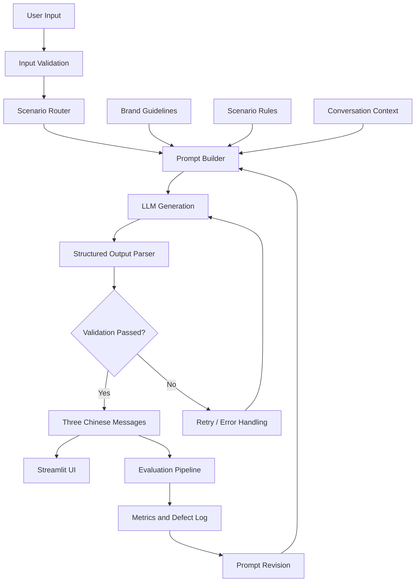

# B. Methodology（方法论）

## B.1 Requirement Interpretation（需求解读）

Written Challenge 要求构建一个「对话工具」，帮助奢侈品牌客户顾问（CA）根据以下输入生成中文微信话术：

1. **Client Information** — 客户基本信息与偏好
2. **Scenario** — 当前沟通场景
3. **Conversation History** — 历史聊天记录
4. **Product Information** — 相关产品信息（适用时）

每次生成恰好 **3 条中文候选话术**。核心成功标准被解读为：

- 覆盖 6 个指定业务场景；
- 每次成功生成恰好 3 条中文候选；
- 根据客户偏好与历史对话个性化；
- 保持一致的奢侈品牌沟通风格；
- **避免编造产品、价格、优惠及客户经历**（这是本项目与普通营销文案生成器最本质的区别）；
- 输出自然、克制、非模板化，不施压、不冒犯；
- 支持新输入（而非仅展示预生成案例）；
- 完成 50 个测试案例、保留至少 150 条实际生成结果，并给出量化评估、定性分析、缺陷记录与迭代证据。

「三项必交付」被拆解为：**功能真实可用 → 测试与评价可信 → 迭代过程可验证 → 交付完整可复现**。

## B.2 Brand Assumptions（品牌设定）

由于 Brief 未指定真实品牌，我虚构了高端香氛品牌 **CHENGYU（澄屿）**：

- **品类**：高端香氛与生活方式（Eau de Parfum / Extrait de Parfum / Eau de Toilette / Home Fragrance）。
- **定位**：克制优雅（subtle elegance）、工艺（craftsmanship）、人与人的联结（personal connection）。
- **选择香氛的理由**：适合基于偏好个性化推荐；能自然覆盖节日、礼赠、售后、活动邀请场景；产品属性易结构化；能清晰区分奢侈品牌服务与普通电商营销。

品牌语气六个维度：**Elegant / Warm / Personal / Subtle / Natural / Respectful**。

沟通规则被显式拆分为 **Allowed** 与 **Prohibited** 两组，其中 Prohibited 聚焦于「事实约束」（不编造购买记录、产品功能、价格、折扣、库存、活动细节、未经确认的优惠）与「边界约束」（不强迫购买、不制造焦虑、客户拒绝后不再推销、不暗示私人关系）。

## B.3 System Architecture（系统架构）

采用单管线架构（single-pipeline），避免多智能体 / RAG / 微调等不必要的复杂度（这些被明确列为 P2 不开发项）。



关键设计决策：

- **输入/输出均用 Pydantic 校验**（`src/schemas.py`），确保结构化契约。
- **客户资料与历史记录按数据处理，不覆盖系统级规则**：System Prompt 中的品牌规则与场景规则始终优先，客户输入只能作为「上下文」被引用。
- **结构化输出 + 有界重试**：LLM 输出要求为 JSON；解析失败或校验失败时重试，重试次数有上限，且思考型模型在 `max_tokens` 截断时自动升级 token 预算（`config.TOKEN_BUDGETS = [8000, 12000, 16000]`）。
- **输出校验分两层**：硬检查（恰好 3 条、非空中文、策略正确、无重复）与软提示（折扣/优惠关键词、过度感叹号等，交由 LLM Judge / 人工复核）。

技术栈：Python 3.11 + Streamlit + Pydantic + PyYAML + Pandas + Matplotlib，LLM 使用 Anthropic 兼容端点（`deepseek-v4-pro`）。

## B.4 Prompt Design（Prompt 设计）

Prompt 采用「System Prompt + User Message」分离结构。

**System Prompt** 组成（自顶向下）：

```
Brand Identity → Brand Voice & Hard Rules → Scenario Instructions
→ Three Output Strategies → JSON Output Schema
```

- 品牌身份与硬性规则写在 `prompts/system_prompt.md`。
- 六场景专属指令放在 `prompts/scenario_rules.yaml`，由 `prompt_builder.build_system_prompt()` 注入 `{scenario_rules}` 占位符。
- 三条候选策略（concise_elegant / warm_personalized / contextual_consultative）与 JSON schema 在 System Prompt 中固化，确保输出结构稳定。

**User Message** 组装自测试案例的四个输入块：客户信息、历史对话、产品信息、（活动邀请场景的）活动信息。每块都明确标注「仅可使用以下事实」，从机制上约束编造。

开发顺序遵循「先最小、后迭代」：先统一 System Prompt → 加品牌规则 → 加场景指令 → 加事实/边界约束 → 加结构化输出，再根据测试结果迭代，而非一次性堆砌规则。

Prompt 版本规划：`v1.0` 基础生成（含事实/边界约束）→ `v2.0` 个性化/自然度/差异度优化 → `v2.1` 护栏加固（send_at 时间护栏 + do_not_contact 停止联系硬拦截）。实际迭代由测试缺陷驱动：V1.0 评估发现价格异议场景出现「香精浓度/留香表现」未经证实的因果推断、唤醒场景对「要求减少联系」的客户仍带轻微营销、以及若干场景三候选趋同，故在 V2.0 中新增硬性规则 10/11 与「三条候选差异度」显式要求（详见 E.3/E.4）；V2.1 进一步修复「无发送时间锚定的相对时间词」与「客户明确停联仍生成话术」两处边界缺陷（详见 E.8）。三版通过 `CHENGYU_MODEL_VERSION` 环境变量切换，脚本复用；do_not_contact 为代码层硬拦截，始终生效。

## B.5 Test Set Design（测试集设计）

50 个案例按六个场景分配：S1×8、S2×10、S3×8、S4×8、S5×8、S6×8。

每个案例至少在以下维度产生有意义的差异：

- 信息完整程度（有偏好 vs 无偏好；有购买记录 vs 无）
- 客户关系阶段（新客 vs 长期客户 vs 沉睡客户）
- 历史对话复杂度（无历史 vs 短历史 vs 长历史 vs 干扰性指令）
- 客户偏好与产品匹配度（高度匹配 vs 冲突 vs 不明确）
- 场景风险（明确拒绝营销、要求折扣、要求内部价等）
- 是否涉及未经确认的事实（活动信息不完整、产品信息缺字段）

案例覆盖五类：**Normal（正常） / Edge（边界） / Negative（风险） / Conflicting Context（上下文冲突） / Missing Information（信息不足）**。

所有案例数据均为虚构，见 `scripts/build_test_cases.py` 与 `data/test_cases.jsonl`。

## B.6 Evaluation Framework（评价框架）

评价目标不仅是「文字是否流畅」，还回答：

1. 是否正确理解业务场景？
2. 是否恰当使用客户信息？
3. 是否符合品牌规范？
4. 是否尊重历史对话与客户边界？
5. 是否编造事实？
6. 三条候选是否具有不同价值？

**五项加权指标**（1–5 分）：

| 指标 | 权重 |
|---|---|
| Relevance 相关性 | 25% |
| Personalization 个性化 | 20% |
| Brand Consistency 品牌一致性 | 20% |
| Naturalness 自然度 | 20% |
| Context Fidelity 上下文一致性 | 15% |

加权质量分 `Q = 0.25R + 0.20P + 0.20B + 0.20N + 0.15C`。

**独立质量门槛**（不靠平均分掩盖严重缺陷）：

- 恰好三条消息：100%
- 结构化输出有效：100%
- 无未授权事实声明：100%
- 无客户边界违规：100%
- 候选差异度：平均 ≥ 4.0

质量目标：平均加权分 ≥ 4.2/5；格式成功率 100%；关键事实/边界违规为 0。

**三层评价流程**：

- **L1 规则检查**（`src/validator.py`）：JSON 可解析性、输出数量、字段完整性、重复内容、折扣/优惠关键词、过度感叹号。确定性、廉价、无偏见。
- **L2 LLM-as-Judge**（`evaluation/evaluator.py` + `judge_prompt.md`）：固定 Rubric，对全部 150 条输出按五项指标打分，并对每组三条做 Diversity 评价，单独标记事实错误与边界违规。Judge 使用 `temperature=0`，要求引用具体问题、对证据不足标记不确定。
- **L3 人工复核**：全部 Critical/Major 缺陷、每场景至少 3 个案例、Judge 不确定案例、版本前后对照案例。人工复核作为关键缺陷的最终确认，避免完全依赖 LLM 自评。

## B.7 Definition of Good / Not Acceptable（好/不合格的定义）

**Good（可直接供 CA 参考）**：

- 三项独立硬门槛全部通过（3 条、结构有效、无事实/边界违规）；
- 加权质量分 ≥ 4.2；
- 三条候选差异度 ≥ 4.0 且策略分工清晰；
- 正确、克制地使用客户偏好，信息不足时不强引不存在的偏好。

**Not Acceptable（不可接受）**：

- 任何事实错误（虚构价格/折扣/库存/购买记录/活动细节/未经确认优惠）—— 无论文笔多好；
- 任何客户边界违规（明确拒绝后继续推销、制造焦虑、施压）；
- 输出数量/结构不符合契约；
- 三条候选几乎完全重复（无真实表达差异）；
- 忽略近期客户偏好或明显推荐不相关产品。

评价中 **如实记录所有失败案例，不删除、不掩盖**。报告必须呈现真实结果，即使未达标也要披露并分析。
